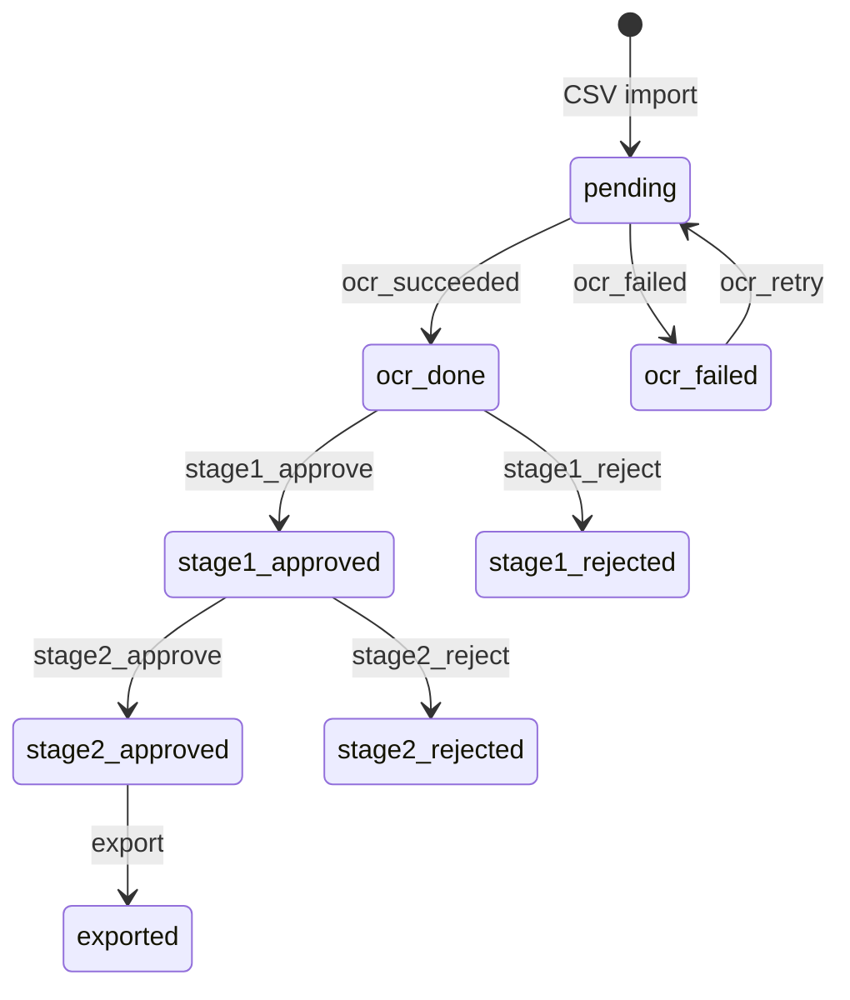

# Module 1: Core API

Implement the API in `app/` and tests in `tests/`. Keep the entry point importable as `app.main:app`. Organize database access, validation, and transition rules into modules within `app/`.

The [Module 1 requirements](../README.md#3-module-1-core-api-35-points) define endpoints, review behavior, and test coverage. The [repository layout](../README.md#2-fixed-structure-and-naming) defines fixed paths and names.

| Module | Responsibility |
|---|---|
| `app/main.py` | FastAPI app and router registration |
| `app/batches.py` | `POST /api/batches`, `GET /api/batches/{id}`, `GET /api/batches/{id}/cases`, and the Module 2 `process` and `export` endpoints |
| `app/cases.py` | `POST /api/cases/{id}/review` |
| `app/exports.py` | Module 2: `POST /api/exports/{id}/deliver`, `GET /api/exports/{id}/file` |
| `app/validation.py` | CSV parsing and row validation |
| `app/state_machine.py` | Case statuses and the transition table |
| `app/db.py` | MongoDB connection, indexes, and the atomic status update |
| `app/schemas.py` | Request and response models |
| `app/config.py` | Settings from environment variables |
| `app/retry.py` | Module 2: HTTP POST with timeouts, bounded retries, and backoff |
| `app/ocr.py` | Module 2: background OCR workers |
| `app/export.py` | Module 2: export CSV creation and delivery to account opening |

## Start the API

The API needs a MongoDB server. From the repository root:

```bash
docker run -d --name mongo -p 27017:27017 mongo:8
```

```bash
python -m pip install -r requirements.txt
cd q1_api
uvicorn app.main:app --reload
```

| Environment variable | Default | Purpose |
|---|---|---|
| `MONGO_URL` | `mongodb://localhost:27017` | MongoDB connection string |
| `MONGO_DB` | `identity_verification` | Database name |

The OCR and account-opening settings are listed in [q2_integration/README.md](../q2_integration/README.md#configuration). The API connects and creates its indexes on the first request that uses the database. Interactive docs are at `http://localhost:8000/docs`.

## Upload a batch

`POST /api/batches` takes a **multipart upload** with the CSV in the form field `file`. Staff upload from their own machine, so the API cannot rely on a path on the server's filesystem. Multipart is also what browsers and `curl -F` send, and it keeps working when the API runs in a container behind nginx.

```bash
curl -sS -F "file=@data/account_applications.csv" http://localhost:8000/api/batches
```

The response is `201` with the batch, its counts, and every rejected row:

```json
{
  "id": "6ad58b1e9445ca9e93233bf4",
  "filename": "account_applications.csv",
  "created_at": "2026-10-19T03:14:38.867000Z",
  "total_rows": 50,
  "accepted_count": 43,
  "rejected_count": 7,
  "rejected_rows": [
    {"row": 6, "case_ref": "APPL-2026-0005", "reasons": ["dob '1975-13-12' is not a valid YYYY-MM-DD date"]},
    {"row": 13, "case_ref": "APPL-2026-0012", "reasons": ["applicant_name is required"]},
    {"row": 18, "case_ref": "APPL-2026-0007", "reasons": ["duplicate case_ref; first appears on row 8"]}
  ],
  "status_counts": {"pending": 43, "ocr_done": 0, "ocr_failed": 0, "stage1_approved": 0,
                    "stage1_rejected": 0, "stage2_approved": 0, "stage2_rejected": 0, "exported": 0}
}
```

### Validation rules

`row` is the row staff see in a spreadsheet. The header is row 1, and every CSV record is one row, including blank lines. A quoted value that contains a line break is still one row, so `row` can be lower than the line number in a text editor. A row is rejected if any rule fails, and `reasons` lists every failure in that row.

| Rule | Example reason |
|---|---|
| All six columns are non-empty after trimming spaces | `applicant_name is required` |
| `id_number` uses the synthetic prefix | `id_number must start with TEST-ID-` |
| `dob` and `issue_date` are real dates in strict `YYYY-MM-DD` form | `dob '32/01/1980' is not a valid YYYY-MM-DD date` |
| `issue_date` is later than `dob` | `issue_date must be after dob` |
| A `case_ref` appears once per file; the first row keeps it | `duplicate case_ref; first appears on row 8` |
| The row has no more values than the header | `row has more values than the header` |

If the file cannot be read at all, nothing is imported and the API returns `422` with the reason, for example `bad.csv: missing required columns: id_number, issue_date, image_ref`. This covers an empty file, a header with no rows, missing columns, and a file that is not UTF-8.

## List cases and review

```bash
curl -sS "http://localhost:8000/api/batches/<batch_id>"
curl -sS "http://localhost:8000/api/batches/<batch_id>/cases?status=pending&page=1&page_size=20"
curl -sS -X POST "http://localhost:8000/api/cases/<case_id>/review" \
  -H 'Content-Type: application/json' -d '{"stage": 1, "decision": "approve"}'
```

Cases are listed in file order. `page` starts at 1, `page_size` is 1 to 100 (default 20), and `total` is the number of matching cases. An unknown `status` value returns `422`. An unknown or malformed batch or case id returns `404`.

## Review state machine

`app/state_machine.py` holds the whole workflow in one table, `TRANSITIONS`, keyed by `(current status, event)`. A review request becomes the event `stage{stage}_{decision}`, for example `stage1_approve`.



A status with no outgoing entry is terminal. That keeps rejected cases out of later reviews and exports without any extra checks. The OCR worker applies `ocr_succeeded` and `ocr_failed`, and export applies `export`. Processing a batch again applies `ocr_retry` only to cases whose OCR retries ran out; an unreadable scan stays `ocr_failed`.

Any event that is not in the table for the case's current status returns `409` with a reason:

```json
{"detail": "'stage2_approve' is not allowed when case status is 'stage1_rejected'; it requires 'stage1_approved'"}
```

`db.transition_case()` writes the new status with `find_one_and_update`, filtered on both the case id and the status it just checked. If two reviewers decide the same case at the same time, only the first update matches; the second gets `409` and the first decision stands.

## MongoDB schema

The database has three collections. Each case is its own document rather than an array inside the batch, because cases change status one at a time and are filtered and paged independently.

### `batches`

One document per upload. It is written once and not changed afterwards. Per-status counts are not stored; `GET /api/batches/{id}` computes them from `cases` with an aggregation, so they cannot drift from the case documents.

| Field | BSON type | Description |
|---|---|---|
| `_id` | ObjectId | Batch id used in the URL |
| `filename` | string or null | Name of the uploaded file |
| `created_at` | date (UTC) | Import time |
| `total_rows` | int | Data rows in the file, excluding the header |
| `accepted_count` | int | Rows imported as cases |
| `rejected_count` | int | Rows not imported |
| `rejected_rows` | array of objects | `{row: int, case_ref: string or null, reasons: [string]}` for each rejected row |

### `cases`

One document per accepted CSV row.

| Field | BSON type | Description |
|---|---|---|
| `_id` | ObjectId | Case id used in `/api/cases/{id}/review` |
| `batch_id` | ObjectId | The `batches._id` this case was imported in |
| `row` | int | Source row in the CSV, used for file-order listing |
| `case_ref` | string | Application reference from the CSV |
| `applicant_name` | string | From the CSV |
| `id_number` | string | From the CSV; always starts with `TEST-ID-` |
| `dob` | string `YYYY-MM-DD` | From the CSV |
| `issue_date` | string `YYYY-MM-DD` | From the CSV |
| `image_ref` | string | Identity-card image reference sent to OCR |
| `status` | string | One of the statuses in the state diagram |
| `ocr` | object | Absent until OCR succeeds. Then the OCR response, stored as returned: `{id_number, full_name, dob, issue_date, confidence}` |
| `ocr_error` | object or null | Absent until OCR fails. `{reason: string, retryable: bool, attempts: int}`. For a `422`, `reason` is the OCR service's message unchanged. Set to null when a later run succeeds. |
| `export_id` | ObjectId | Absent until the case is exported. The `exports._id` of the one export that contains it |
| `created_at` | date (UTC) | Import time |
| `updated_at` | date (UTC) | Time of the last status change |

Dates of birth and issue dates are stored as validated `YYYY-MM-DD` strings. They are calendar dates with no time zone, and a BSON date would add a time and a time zone that the data does not have. The ISO format still sorts and compares correctly as a string.

Example of an exported case:

```json
{
  "_id": {"$oid": "6ad58b1e9445ca9e93233bf5"},
  "batch_id": {"$oid": "6ad58b1e9445ca9e93233bf4"},
  "row": 2,
  "case_ref": "APPL-2026-0001",
  "applicant_name": "Test Applicant 001",
  "id_number": "TEST-ID-000001",
  "dob": "1961-02-02",
  "issue_date": "2021-02-02",
  "image_ref": "id_scan_0001.jpg",
  "status": "exported",
  "ocr": {"id_number": "TEST-ID-830454", "full_name": "Test Applicant 0454", "dob": "1969-11-19",
          "issue_date": "2020-06-06", "confidence": 0.94},
  "ocr_error": null,
  "export_id": {"$oid": "6ad5a62d194e910fd65fedda"},
  "created_at": {"$date": "2026-10-19T03:14:38.867Z"},
  "updated_at": {"$date": "2026-10-19T04:10:05.112Z"}
}
```

An unreadable scan instead ends with `"status": "ocr_failed"` and `"ocr_error": {"reason": "cannot read identity-card fields from 'id_badscan_0009.jpg' (scan quality)", "retryable": false, "attempts": 1}`.

### `exports`

One document per export. The CSV is stored in the document, so the file is backed up with the database and can be delivered again or downloaded later.

| Field | BSON type | Description |
|---|---|---|
| `_id` | ObjectId | Export id. It is chosen before any case is claimed, and the filename and key derive from it. |
| `batch_id` | ObjectId | The batch the cases came from |
| `filename` | string | `EXPORT-<_id>.csv`; sent as `X-File-Name` |
| `idempotency_key` | string | Same value as `filename`; sent as `Idempotency-Key` on every delivery attempt |
| `created_at` | date (UTC) | Export time |
| `case_refs` | array of strings | The exported cases, in file order |
| `csv` | string | The export file: the CSV columns plus `ocr_*` columns, one row per case |
| `sha256` | string | SHA-256 of `csv`; matches the receipt's `sha256` |
| `delivery` | object | `{status: "pending" \| "delivered" \| "failed", attempts: int, receipt: object or null, error: string or null, updated_at: date}`. `receipt` is the account-opening receipt, stored as returned. `attempts` counts every delivery attempt for this export. |

### Indexes

| Collection | Index | Purpose |
|---|---|---|
| `cases` | `{batch_id: 1, case_ref: 1}`, unique | A `case_ref` identifies one application within a batch. The database enforces this as well as the validator. |
| `cases` | `{batch_id: 1, row: 1}` | Listing a batch's cases in file order |
| `cases` | `{batch_id: 1, status: 1, row: 1}` | Listing with a status filter, per-status counts, and finding pending cases to process |
| `cases` | `{export_id: 1}`, sparse | Reading back the cases an export claimed |
| `exports` | `{batch_id: 1, created_at: 1}` | Listing a batch's exports |

### Write order

An import inserts the cases first and the batch document last. A standalone MongoDB server has no multi-document transactions, so this order means a batch never appears with only part of its cases. If the import fails partway, the inserted cases have no batch document, so no endpoint lists them.

Duplicate `case_ref` values are checked within one file. Uploading the same file twice creates two separate batches.

An export works the other way round: it claims its cases first and writes the export document last. Each claim is a compare-and-set update from `stage2_approved` to `exported` that also sets `export_id`. If the process stops between the claims and the export document, the next export call finds cases whose `export_id` has no document. It reuses that id, so the recovered export keeps the same filename and key.

## Run tests

From the repository root:

```bash
python -m pytest q1_api/
```

The Module 2 tests replace the OCR and account-opening services with in-process fakes that behave like the mocks, through `httpx.MockTransport`. They need no running services and do not wait for retry backoff.

The tests use [mongomock](https://github.com/mongomock/mongomock), an in-memory MongoDB, so they pass from a clean checkout without a database server. To run the same tests against a real server, set `TEST_MONGO_URL`. Each test creates its own `idv_test_*` database and drops it afterwards.

```bash
TEST_MONGO_URL=mongodb://localhost:27017 python -m pytest q1_api/
```

| Test file | Covers |
|---|---|
| `tests/test_batches.py` | Sample CSV import with exact counts and per-row reasons, multiple problems in one row, row numbers after a multi-line value and a blank line, unreadable files, filtering and pagination, `404` for unknown batches |
| `tests/test_review.py` | Successful lifecycle through stage 2 approval, five invalid transitions that return `409`, concurrent reviews of one case, malformed review requests |
| `tests/test_ocr.py` | Module 2: `process` returns before OCR finishes; stored fields; the `422` reason stored unchanged and not retried; retries after `500`s and timeouts; exhausted retries recorded and retried on the next run; a case interrupted mid-OCR processed again; OCR request bodies match the contract |
| `tests/test_export.py` | Module 2: an export holds exactly the `stage2_approved` cases; a later export skips exported cases; retries after a lost response or `500`s reuse the key and ingest once; exhausted delivery recorded and delivered again; overlapping deliveries in either order keep the success and count every attempt; recovery of cases claimed before a crash |
| `tests/test_retry.py` | Module 2: a `4xx` is not retried; connect timeouts, read timeouts, and refused connections are retried and each gets its own error text |

The five `409` tests are: stage 2 review before stage 1 finishes, review before OCR finishes, review of an `ocr_failed` case, repeating a stage 1 decision, and stage 2 review after a stage 1 rejection. Each also checks that the case status did not change.
